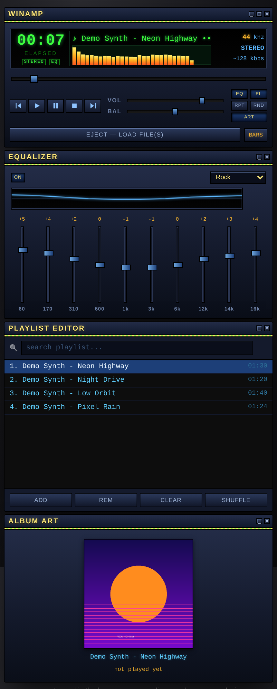
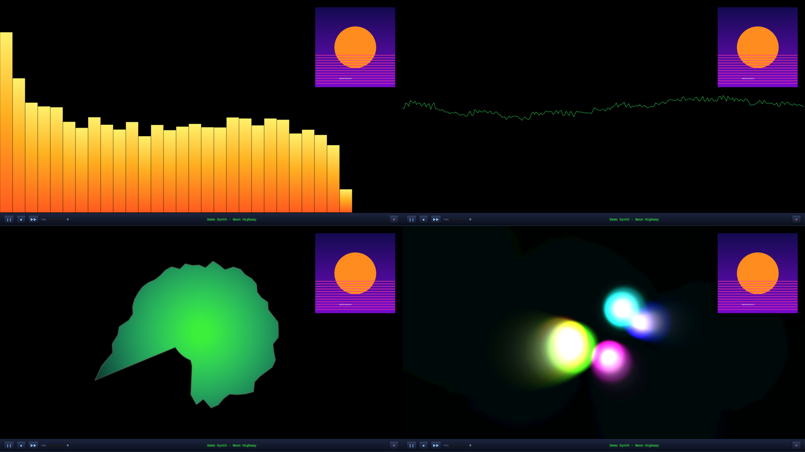
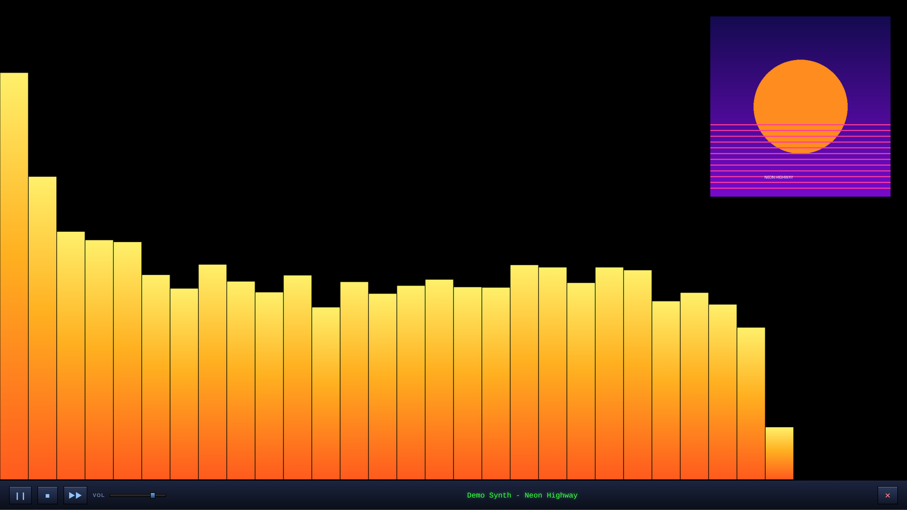
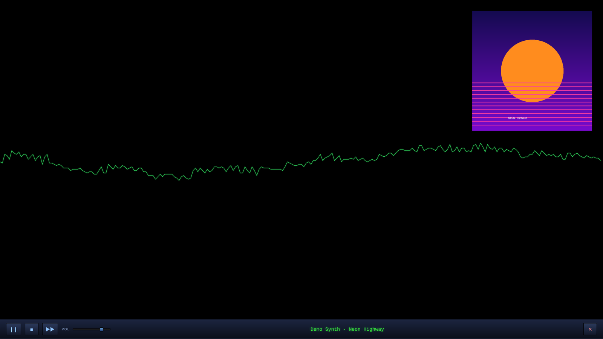
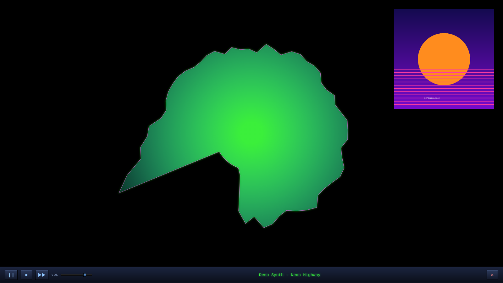
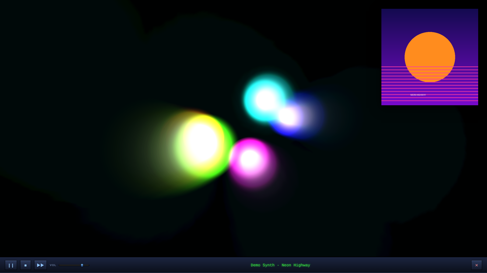
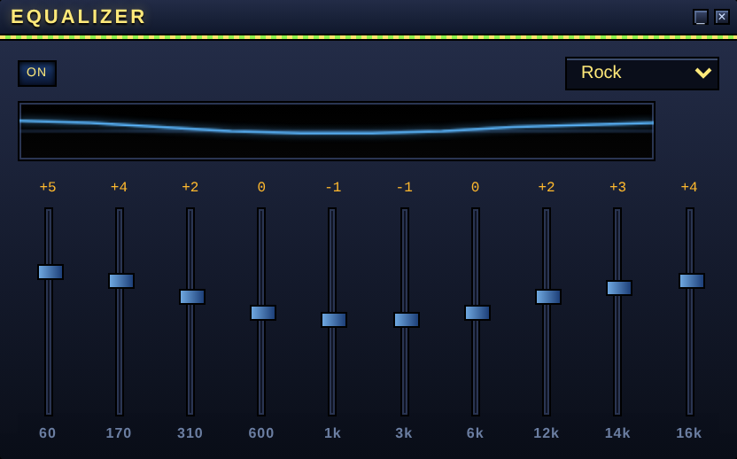
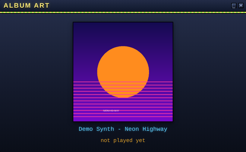

# WinAmp — Reconstructed

**It really whips the llama's ass. Again.** 🦙

A full Winamp-style media player rebuilt from scratch as **one self-contained HTML file**: classic skin, real 10-band equalizer, playlist editor, album art, and four music visualizers that actually react to your music. No install, no account, no internet. Your music never leaves your computer.

<h3 align="center">▶️ <a href="https://hardwaremack-prog.github.io/Winamp-Reconstructed/">Play it right now in your browser</a></h3>
<p align="center">No download needed. Click the link, hit <b>EJECT</b>, pick some MP3s, and go.</p>

<p align="center">
  
</p>

---

## Why I made this

For a lot of us, Winamp *was* the player. The first songs we ever traded with friends (Spice Girls, Beastie Boys, AC/DC) got dropped into that little dark window, the visualizer kicked in, and that was the soundtrack to growing up with computers. You loaded up the playlist, cranked the EQ, and let it whip the llama's ass.

I wanted that feeling back, but in something that runs anywhere today: on my Windows PCs, on my Raspberry Pis, in any browser. So I rebuilt it. Same look, same attitude, plus a few things I always wished it had.

---

## Quick start

**Easiest:** open **[hardwaremack-prog.github.io/Winamp-Reconstructed](https://hardwaremack-prog.github.io/Winamp-Reconstructed/)** and it plays right there in your browser window. Your songs still stay on your computer; the page just reads them locally.

**Or keep your own copy:**

1. Download **[`winamp16.html`](winamp16.html)** (or `index.html`, they're the same file).
2. Double-click it to open it in Chrome, Edge, Firefox or Safari.
3. Click **EJECT — LOAD FILE(S)**, or drag MP3s anywhere onto the player.
4. Hit play.

That's it. Works on Windows, Mac, Linux and Raspberry Pi (Pi 400 / Pi 500 tested).

---

## The visualizers

Click the little amber strip in the display to cycle modes. **Double-click it to go fullscreen**, with album art in the corner and a mini transport bar (play/pause, stop, next, volume) along the bottom. Single-click still cycles modes in fullscreen; double-click, **Esc** or ✕ gets you out.

Every mode is driven by real audio analysis (Web Audio API), not a canned animation, so the bars, waves and colors move with *your* song.

<p align="center">
  
</p>

| Mode | What it does |
|---|---|
| **Bars** | The classic amber-to-orange spectrum analyzer, bass on the left, treble on the right. |
| **Scope** | Green oscilloscope line tracing the actual waveform, just like the old built-in scope. |
| **Radial** | A rotating, color-cycling blob of the spectrum wrapped around a circle. Pulses with the beat. |
| **Geiss** | A feedback-plasma mode in the spirit of the legendary Geiss plugin. Glowing orbs ride the bass, mids and treble while the trails bloom and warp frame to frame. Put this one fullscreen on a big TV. |

<details>
<summary>Full-size fullscreen shots</summary>






</details>

---

## Cool features

### 🎚️ A real 10-band equalizer


- 10 bands, 60 Hz to 16 kHz, each **±12 dB**, built from real audio filters, so you actually hear the change.
- Presets: **Flat, Rock, Pop, Jazz, Classical, Bass Boost, Treble Boost, Vocal**.
- A live blue curve shows your EQ shape.
- **ON** button bypasses the whole EQ without losing your settings.

<br clear="right">

### 📃 Playlist editor
- Add a whole stack of files at once, or drag and drop them in.
- **Drag tracks to reorder.**
- **Live search box** to filter a big playlist as you type.
- **Play-count badges** show how many times each song has played all the way through.
- REM, CLEAR and a one-time SHUFFLE of the list order.

### 💾 Playlists that survive closing the browser
This is the one the original never had in a browser. Your actual audio is stored locally in the browser (IndexedDB), so when you close the tab and come back tomorrow, **your playlist is still there and still playable**. Your EQ settings, preset, volume, balance, visualizer mode and repeat mode come back too.

### 🖼️ Album art


- **Cover art embedded in your MP3s is found and shown automatically** (read straight from the ID3 tags).
- No cover? Click the frame and pick any picture. It's remembered for that song.
- The same art shows up big in the corner of the fullscreen visualizer.

<br clear="right">

### 🔁 Repeat & shuffle
- **RPT** cycles Off → Repeat All → Repeat One.
- **RND** turns on continuous shuffle playback.

### ⌨️ Keyboard shortcuts
| Key | Action |
|---|---|
| **Space** | Play / pause |
| **← / →** | Seek back / forward |
| **↑ / ↓** | Volume up / down |
| **Esc** | Leave fullscreen visualizer |

### The little things
- Click the time to flip between **elapsed and remaining**.
- Scrolling track-title marquee that glides back and forth.
- Working **STEREO** and **EQ** lights, kHz and kbps readouts.
- **Double-click the BAL slider** to snap it back to center.
- Show or hide the EQ, Playlist and Art windows with the **EQ / PL / ART** buttons.

---

## Make your music library look the part: MP3 standardizing + album art

Winamp looks best when your files are clean: **"Artist - Title"** names and real cover art. If your library is full of downloader junk like

```
YTDown.com_YouTube_AC-DC-Moneytalks-Official-HD-Video_Media_2lqdErI9uss_009_128k.mp3
```

run it through my companion tool, **[Music Standardizer](https://github.com/hardwaremack-prog/music-standardizer)**, first. It:

- Renames files to a clean **`Artist - Title.mp3`** pattern and writes proper ID3 tags.
- Knows tricky artist names (AC/DC, Jay-Z, T-Pain...) so they don't get mangled.
- Can **look up and embed album art** for each song (free iTunes search, no key needed).
- Lets you preview everything (dry run) before it touches a single file.

Then drop the cleaned-up folder into WinAmp Reconstructed and every track shows up with the right name and its cover art, in the Album Art window and in the fullscreen visualizer.

---

## Privacy

Everything runs locally in your browser. Nothing is uploaded, nothing is tracked, and it works with no internet connection at all.

## Manual

A full user manual is in [`docs/Winamp_Reconstructed_Manual.pdf`](docs/Winamp_Reconstructed_Manual.pdf).

## Notes

- Screenshots were made with synth demo tracks and home-made cover art.
- This is a fan-made, from-scratch tribute. It contains no original Winamp code or skin files and isn't affiliated with or endorsed by Winamp or its owners.

Built with Claude by **hardwaremack**.
